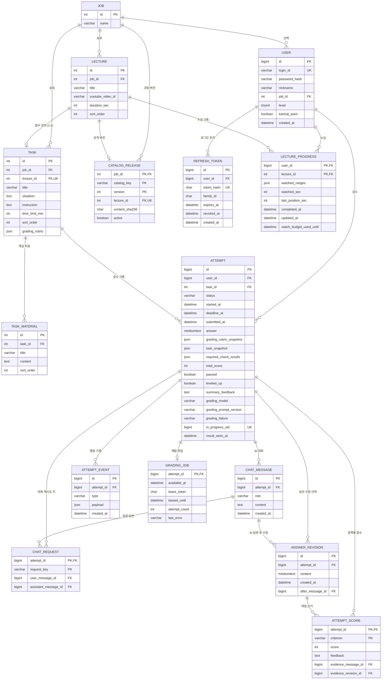

# ERD

DB: MySQL 8. 문자셋 `utf8mb4`. 모든 시각은 UTC로 저장한다. `DATETIME`은 시간대 정보가 없으므로 API 응답에서 UTC(`Z`)를 붙여 내보낸다.

## 1. 다이어그램



## 2. 테이블 상세

### job (직무)

| 컬럼 | 타입 | 제약 | 설명 |
|---|---|---|---|
| id | INT | PK, AUTO_INCREMENT | |
| name | VARCHAR(50) | NOT NULL, UNIQUE | 직무 이름. MVP는 "무역 사무" 하나 |

### user (회원)

| 컬럼 | 타입 | 제약 | 설명 |
|---|---|---|---|
| id | BIGINT | PK, AUTO_INCREMENT | |
| login_id | VARCHAR(30) | NOT NULL, UNIQUE | 로그인 아이디 |
| password_hash | VARCHAR(255) | NOT NULL | 해시한 비밀번호. 원문은 저장하지 않음 |
| nickname | VARCHAR(20) | NOT NULL | |
| job_id | INT | FK → job.id, NOT NULL | 가입할 때 고른 직무 |
| level | TINYINT | NOT NULL, 기본 1 | 현재 레벨. 1~5, 6은 Lv.MAX |
| tutorial_seen | BOOLEAN | NOT NULL, 기본 false | 첫 입장 안내를 봤는지 |
| created_at | DATETIME | NOT NULL | |

- 레벨은 저장한다. 채점을 저장할 때마다 `level = min(1 + 통과한 서로 다른 과제 수, 6)`으로 다시 계산한다. 이미 통과한 과제를 다시 통과하면 값이 그대로라 오르지 않고, 값이 어긋나도 다음 채점 때 바로잡힌다.
- 채점 저장과 레벨 갱신은 한 트랜잭션으로 처리하고, 이때 사용자 행을 `SELECT ... FOR UPDATE`로 잠근다. 동시에 채점돼도 레벨이 두 번 오르지 않는다.

### lecture (강의)

| 컬럼 | 타입 | 제약 | 설명 |
|---|---|---|---|
| id | INT | PK, AUTO_INCREMENT | |
| job_id | INT | FK → job.id, NOT NULL | |
| title | VARCHAR(100) | NOT NULL | |
| youtube_video_id | VARCHAR(20) | NOT NULL | 유튜브 영상 ID 또는 `local:<키>` 형식의 같은 출처 MP4 식별자 |
| duration_sec | INT | NOT NULL | 영상 길이(초). 수강률 계산에 쓴다 |
| sort_order | INT | NOT NULL | 대시보드 표시 순서 |

### catalog_release (공개 과정 버전)

| 컬럼 | 타입 | 제약 | 설명 |
|---|---|---|---|
| job_id | INT | PK, FK → job.id | 직무 |
| catalog_key | VARCHAR(64) | PK | 같은 과정의 안정적인 키 |
| version | INT | PK | 과정 버전 |
| lecture_id | INT | FK → lecture.id, UNIQUE | 이 버전의 강의와 연결 과제 |
| content_sha256 | CHAR(64) | NOT NULL | 강의·과제·자료·루브릭 묶음의 해시 |
| active | BOOLEAN | NOT NULL | 현재 목록과 신규 응시에 노출할 버전 |

- 같은 `job_id + catalog_key`에서 활성 버전만 강의·과제 목록에 노출한다. 비활성 버전의 기존 진행 기록과 응시 결과는 보존한다.
- 과정이 개정되면 기존 행을 덮어쓰지 않고 새 강의·과제·자료와 새 버전을 만든다. 결과의 추천 강의는 같은 과정 키의 현재 활성 강의를 가리킨다.
- 한 공개 과정 버전의 직렬화된 과제·자료·루브릭은 32KiB를 넘을 수 없다. 채점 입력 전체 256KiB 한도 안에 항상 들어오도록 공개 단계에서 검사한다.

### lecture_progress (수강 기록)

| 컬럼 | 타입 | 제약 | 설명 |
|---|---|---|---|
| user_id | BIGINT | PK, FK → user.id | |
| lecture_id | INT | PK, FK → lecture.id | |
| watched_ranges | JSON | NOT NULL | 실제로 본 구간 목록. 예: `[[0,120],[300,410]]` (초). 겹치는 구간은 합쳐서 저장 |
| watched_sec | INT | NOT NULL | 본 구간의 합(초) |
| last_position_sec | INT | NOT NULL | 이어 보기 위치 |
| completed_at | DATETIME | NULL | `watched_sec / duration_sec ≥ 0.8`이 된 시각. NULL이면 미완료 |
| updated_at | DATETIME | NOT NULL | 마지막 보고 시각 |
| watch_budget_used_until | DATETIME | NULL | 시청 시간 인정에 사용하는 기준 시각. 연속 보고에서 5초 허용 오차가 누적되지 않게 한다 |

- 내부 수강률은 `watched_sec / lecture.duration_sec`다. 완료 전 API 표시값은 최대 `0.79`이며, `watched_sec × 5 >= duration_sec × 4`를 만족한 정확한 80%부터 완료 처리한다.
- 구간을 합쳐서 저장하므로 같은 구간을 여러 번 봐도 한 번만 센다. 앞으로 건너뛴 구간은 기록되지 않는다.

### task (과제)

| 컬럼 | 타입 | 제약 | 설명 |
|---|---|---|---|
| id | INT | PK, AUTO_INCREMENT | |
| job_id | INT | FK → job.id, NOT NULL | |
| lecture_id | INT | FK → lecture.id, UNIQUE, NOT NULL | 필수 강의 (1:1). 과제마다 강의 하나, 강의마다 연결 과제 최대 하나 |
| title | VARCHAR(100) | NOT NULL | |
| situation | TEXT | NOT NULL | 상황 설명 |
| instruction | TEXT | NOT NULL | 해야 할 일 |
| time_limit_min | INT | NOT NULL, 기본 30 | 제한 시간(분) |
| sort_order | INT | NOT NULL | 과제 목록 표시 순서 |
| grading_rubric | JSON | NOT NULL | 채점 기준. 버전, 항목별 배점, 최소 점수, 과제별 필수 요건을 담는다 |

- 과제와 필수 강의의 직무는 같아야 한다. 서버는 같은 직무의 과제에 대해 필수 강의의 수강 완료를 확인한 뒤 응시를 생성한다.
- 필수 요건의 `check_id`는 과제 기준 안에서 유일하다. `label`은 응시자에게 공개하고, `rule`은 채점에 사용한다. 무역 사무 MVP의 채점 기준은 아래 형식을 따른다.

```json
{
  "version": "DUAL_V1",
  "task_solution_min_score": 40,
  "ai_use_min_score": 40,
  "verify_min_score": 12,
  "required_checks": [
    {
      "check_id": "SHIPPING_DATE",
      "label": "확정 선적일을 정확히 안내하고 미확정 일정을 확정처럼 약속하지 않기",
      "rule": "최종 회신의 확정 선적일이 제공된 선적 일정표와 일치하고, 일정표에서 미확정으로 표시된 날짜를 확정 일정이라고 약속한 문장이 없으면 충족한다."
    }
  ],
  "criterion_max_scores": {
    "RESULT": 50,
    "PROMPT": 15,
    "VERIFY": 20,
    "IMPROVE": 15
  }
}
```

### task_material (과제 제공 자료)

| 컬럼 | 타입 | 제약 | 설명 |
|---|---|---|---|
| id | INT | PK, AUTO_INCREMENT | |
| task_id | INT | FK → task.id, NOT NULL | |
| title | VARCHAR(100) | NOT NULL | 예: "바이어 메일 원문", "선적 일정표" |
| content | TEXT | NOT NULL | 자료 본문 (마크다운) |
| sort_order | INT | NOT NULL | |

### attempt (응시)

| 컬럼 | 타입 | 제약 | 설명 |
|---|---|---|---|
| id | BIGINT | PK, AUTO_INCREMENT | |
| user_id | BIGINT | FK → user.id, NOT NULL | |
| task_id | INT | FK → task.id, NOT NULL | |
| status | VARCHAR(20) | NOT NULL | 아래 상태 참고 |
| started_at | DATETIME | NOT NULL | 시험장에서 ‘시험 시작’을 눌러 서버가 응시를 생성한 시각 |
| deadline_at | DATETIME | NOT NULL | `started_at + 제한 시간`. 서버가 이 시각 기준으로 자동 제출 |
| submitted_at | DATETIME | NULL | 제출 시각 |
| answer | MEDIUMTEXT | NULL | 최종 답안. 최대 20,000자, JSON 직렬화 기준 96KiB |
| grading_rubric_snapshot | JSON | NOT NULL | 응시를 생성할 때 복사한 채점 기준. 이어 풀기, 자동 제출, 채점 재시도, 결과 조회에 사용 |
| task_snapshot | JSON | NULL | 응시 시작 시 복사한 과제 제목·상황·지시·자료. 새 응시는 `FROZEN`, 이 컬럼이 없는 이전 응시는 `LEGACY_LIVE`로 표시 |
| required_check_results | JSON | NULL | 필수 요건별 `check_id`, `met`, `feedback` 배열. 두 영역 기준으로 채점이 끝나면 저장 |
| total_score | INT | NULL | 0~100. 채점 완료 시 네 항목의 합을 저장 |
| passed | BOOLEAN | NULL | 채점 완료 시 두 영역이 모두 충족되면 `true`. 적용 기준은 응시에 저장된 스냅샷 버전으로 결정 |
| leveled_up | BOOLEAN | NULL | 이 응시로 레벨이 올랐는지. 결과 화면의 레벨업 연출에 쓴다 |
| summary_feedback | TEXT | NULL | 시험관 총평 |
| grading_model | VARCHAR(100) | NULL | 채점에 사용한 모델 식별자 |
| grading_prompt_version | VARCHAR(32) | NULL | 채점 프롬프트 버전 |
| grading_failure | VARCHAR(100) | NULL | 마지막 채점 실패 분류. 답안·자료 원문은 넣지 않는다 |
| result_seen_at | DATETIME | NULL | 사용자가 채점 결과를 처음 본 시각. 나가 있는 동안 자동 제출된 시험의 결과를 다음 방문 때 안내하는 데 쓴다 |
| in_progress_uid | BIGINT | 생성 컬럼, UNIQUE | `IF(status = 'IN_PROGRESS', user_id, NULL)`. 사용자당 시험 중 응시를 하나로 제한한다 (MySQL은 조건부 UNIQUE 인덱스가 없어 생성 컬럼으로 대신한다) |

상태 (`status`):

| 값 | 뜻 |
|---|---|
| IN_PROGRESS | 시험 중 |
| GRADING | 제출 후 채점 중 |
| GRADED | 채점 완료 |
| GRADING_FAILED | 채점 실패. 재시도 대상 |

- 한 사용자는 동시에 `IN_PROGRESS` 응시를 하나만 가진다. `in_progress_uid`의 UNIQUE 제약으로 DB가 보장한다.
- 시험 중에 나가거나 브라우저를 닫아도 응시는 그대로 남는다. 다시 오면 이어 푼다.
- "포기하기"는 마감 전 `IN_PROGRESS` 응시만 삭제한다. 마감 시각 이후 요청은 서버 자동 제출 대상으로 처리하며 삭제하지 않는다.
- 마감 뒤 1분 유예 동안 수동 제출할 수 있지만, 최종 답안은 마감 전에 서버가 저장한 마지막 `answer_revision`이다. 마감 시각에서 1분이 지나면 주기 작업이 사용자 요청 없이 자동 제출한다.
- 통과한 과제 수는 `status = GRADED AND passed = true`인 서로 다른 과정 수다. `catalog_release`가 있는 과제는 `job_id + catalog_key`별 한 번만 세어 버전이 바뀌어도 중복 레벨업하지 않고, 공개 과정에 속하지 않은 기존 과제는 `task_id`별로 센다.
- 이전 명세로 생성한 응시가 있다면, 배포 시 기존 응시에 `{"version":"LEGACY_TOTAL_V1","criterion_max_scores":{"RESULT":25,"PROMPT":25,"VERIFY":25,"IMPROVE":25},"min_total_score":80}`을 채운 후 스냅샷 컬럼을 `NOT NULL`로 설정한다. 이미 완료한 점수와 판정은 보존한다. 기존 미완료 응시는 저장된 이전 기준을 적용하고, 전환 이후 시작하는 응시는 과제의 새 기준을 복사한다.

### refresh_token (로그인 유지 토큰)

| 컬럼 | 타입 | 제약 | 설명 |
|---|---|---|---|
| id | BIGINT | PK, AUTO_INCREMENT | |
| user_id | BIGINT | FK → user.id, NOT NULL, ON DELETE CASCADE | |
| token_hash | CHAR(64) | NOT NULL, UNIQUE | 리프레시 토큰의 SHA-256 해시. 토큰 원문은 저장하지 않음 |
| family_id | CHAR(64) | NOT NULL, INDEX | 같은 로그인에서 회전된 리프레시 토큰이 공유하는 세션 식별자 |
| expires_at | DATETIME | NOT NULL | 발급 후 14일 |
| revoked_at | DATETIME | NULL | 로그아웃 또는 재발급으로 폐기된 시각 |
| created_at | DATETIME | NOT NULL | |

- 재발급할 때마다 기존 토큰을 폐기하고 같은 로그인 세션에 속하는 새 토큰을 발급한다. 로그아웃하면 그 세션의 활성 리프레시 토큰을 폐기한다.
- `family_id`는 액세스 토큰의 `sid`와 같다. REST 요청마다 활성 세션인지 확인하고, 로그아웃하면 같은 `sid`의 기존 액세스 토큰과 WebSocket도 무효가 된다.
- 회전 직후 10초 안에 이전 리프레시 토큰이 다시 오면 정상 경합으로 보고 401만 반환한다. 10초가 지난 재사용은 해당 `family_id` 전체를 폐기한다.

### chat_message (AI 대화)

| 컬럼 | 타입 | 제약 | 설명 |
|---|---|---|---|
| id | BIGINT | PK, AUTO_INCREMENT | 순서는 id로 정한다 |
| attempt_id | BIGINT | FK → attempt.id, NOT NULL | |
| role | VARCHAR(10) | NOT NULL | `USER` 또는 `ASSISTANT` |
| content | TEXT | NOT NULL | |
| created_at | DATETIME | NOT NULL | |

- AI 대화는 최대 40턴이다. 대화와 답안 수정 이력은 JSON 직렬화 크기에 행당 160바이트 여유분을 더한 합계 64KiB까지만 저장한다.

### chat_request (AI 대화 멱등 기록)

| 컬럼 | 타입 | 제약 | 설명 |
|---|---|---|---|
| attempt_id | BIGINT | PK, FK → attempt.id, ON DELETE CASCADE | 응시 |
| request_key | VARCHAR(64) | PK, `utf8mb4_bin` | 클라이언트의 `Idempotency-Key` |
| user_message_id | BIGINT | FK → chat_message.id, ON DELETE CASCADE | 저장된 질문 |
| assistant_message_id | BIGINT | FK → chat_message.id, ON DELETE CASCADE | 저장된 답변 |

- 같은 응시와 요청 키로 같은 질문을 재전송하면 저장된 질문·답변을 반환한다. 같은 키에 다른 질문을 보내면 충돌로 거부한다.

### answer_revision (답안 수정 이력)

| 컬럼 | 타입 | 제약 | 설명 |
|---|---|---|---|
| id | BIGINT | PK, AUTO_INCREMENT | |
| attempt_id | BIGINT | FK → attempt.id, NOT NULL | |
| content | MEDIUMTEXT | NOT NULL | 그 시점의 답안 전체. 최대 20,000자, JSON 직렬화 기준 96KiB |
| created_at | DATETIME | NOT NULL | |
| after_message_id | BIGINT | FK → chat_message.id, NULL, ON DELETE SET NULL | 저장 당시 가장 최근 AI 답변. 같은 초에 저장해도 AI 응답 뒤의 수정인지 판별한다 |

- 입력할 때마다가 아니라, 입력이 멈춘 뒤 3초가 지나면 저장한다.
- 가장 최근 행이 현재 답안이다. 이어 풀기와 서버 자동 제출에 쓴다.
- 응시당 최대 1,500개를 저장하며, `chat_message`와 합친 64KiB 한도를 적용한다. 저장 요청의 `expected_revision_id`가 현재 최신 수정본과 다르면 오래 도착한 요청으로 보고 거부한다.

### attempt_event (시험 중 행동 기록)

| 컬럼 | 타입 | 제약 | 설명 |
|---|---|---|---|
| id | BIGINT | PK, AUTO_INCREMENT | |
| attempt_id | BIGINT | FK → attempt.id, NOT NULL | |
| type | VARCHAR(20) | NOT NULL | `PASTE`(붙여넣기), `BLUR`(다른 창으로 이동), `FOCUS`(돌아옴) |
| payload | JSON | NULL | 예: 붙여넣은 글자 수 |
| created_at | DATETIME | NOT NULL | |

- 응시당 최대 600개를 저장한다. 채점에는 이벤트 원문을 나열하지 않고 유형별 개수만 전달한다.

### attempt_score (항목별 점수)

| 컬럼 | 타입 | 제약 | 설명 |
|---|---|---|---|
| attempt_id | BIGINT | PK, FK → attempt.id | |
| criterion | VARCHAR(20) | PK | `RESULT`(결과물), `PROMPT`(질문 설계), `VERIFY`(답변 검증), `IMPROVE`(개선 과정) |
| score | INT | NOT NULL | 0부터 스냅샷의 항목별 배점까지의 정수 |
| feedback | TEXT | NOT NULL | 항목별 피드백과 근거. 최종 답안, 제공 자료, 대화, 답안 수정 이력에서 관련 내용을 구체적으로 짚는다 |
| evidence_message_id | BIGINT | FK → chat_message.id, NULL, ON DELETE SET NULL | 근거가 된 대화 장면. 같은 응시의 대화가 아니면 저장하지 않는다 |
| evidence_revision_id | BIGINT | FK → answer_revision.id, NULL, ON DELETE SET NULL | 근거가 된 답안 수정본. AI 답변 이후 학습자가 남긴 수정만 검증 근거가 될 수 있다 |

- 채점 완료한 응시 하나에 4행을 저장한다. 네 점수의 합은 `attempt.total_score`이며, 영역별 점수와 충족 여부는 항목별 점수, 스냅샷, 필수 요건 판정으로 계산한다.

### grading_job (지속 채점 작업)

| 컬럼 | 타입 | 제약 | 설명 |
|---|---|---|---|
| attempt_id | BIGINT | PK, FK → attempt.id, ON DELETE CASCADE | 채점할 응시. 응시를 `GRADING`으로 바꾸는 트랜잭션에서 함께 생성 |
| available_at | DATETIME | NOT NULL, INDEX | 다음 실행 가능 시각 |
| lease_token | CHAR(36) | NULL | 현재 작업자의 처리권 토큰 |
| leased_until | DATETIME | NULL | 처리권 만료 시각. 기본 15분 |
| attempt_count | INT | NOT NULL, 기본 0 | 처리권 획득 횟수. 최대 3회 |
| last_error | VARCHAR(100) | NULL | 최근 실패 분류 |

- 작업자는 1초마다 만료 응시와 실행 가능한 작업을 조회하고, `SKIP LOCKED`와 처리권 토큰으로 중복 실행을 막는다. 최대 두 작업을 동시에 실행한다.
- 일시적 제공자 오류는 5초, 30초 뒤 다시 시도한다. 세 번째 실패 또는 유효하지 않은 채점 출력은 `GRADING_FAILED`로 끝낸다.
- 점수 저장 시 처리권 토큰과 15분 만료 시각을 다시 확인한다. 오래된 작업자는 결과와 레벨을 확정할 수 없다.

## 3. 두 영역 채점과 통과 기준

| 영역 | 항목 | MVP 배점 | 채점 근거 |
|---|---|---:|---|
| 실무 과제 해결 (`TASK_SOLUTION`) | `RESULT` 결과물 | 50 | 최종 답안이 요구사항을 충족하고, 제공 자료와 사실이 일치하며, 실무에서 사용할 수 있는지 평가한다 |
| AI 활용 역량 (`AI_USE`) | `PROMPT` 질문 설계 | 15 | 업무 목표와 맥락, 제약조건, 원하는 산출물을 AI에 명확히 전달했는지 평가한다 |
| AI 활용 역량 (`AI_USE`) | `VERIFY` 답변 검증 | 20 | AI가 제시한 핵심 사실·가정을 원자료와 대조하고 오류나 불확실성을 처리했는지 평가한다. 대화와 답안 수정 이력에서 검증 근거를 확인할 수 없으면 0점이다 |
| AI 활용 역량 (`AI_USE`) | `IMPROVE` 개선 과정 | 15 | 검증 결과나 판단 근거를 바탕으로 초안을 개선하거나 기존 내용을 유지할 이유를 보여줬는지 평가한다 |

MVP의 `DUAL_V1` 기준은 다음과 같다. 각 응시의 배점, 최소 점수, 필수 요건은 저장된 스냅샷을 사용한다.

```text
실무 과제 해결 점수 = RESULT
실무 과제 해결 충족 = RESULT >= 40 AND 모든 필수 요건의 met = true
AI 활용 역량 점수 = PROMPT + VERIFY + IMPROVE
AI 활용 역량 충족 = AI 활용 역량 점수 >= 40 AND VERIFY >= 12
최종 통과 = 실무 과제 해결 충족 AND AI 활용 역량 충족
총점 = 실무 과제 해결 점수 + AI 활용 역량 점수
```

예를 들어 납기 지연 회신 과제에서 최종 메일의 선적일이 일정표와 일치하면 결과물 평가에 반영한다. 학습자가 AI의 날짜 제안을 일정표와 대조한 기록은 검증 항목에 반영한다. 총점이 85점이어도 검증이 11점이면 미통과다.

## 4. 화면에서 쓰는 값 계산

| 화면 값 | 계산 |
|---|---|
| 레벨 | `user.level` |
| 강의별 수강률 | `lecture_progress.watched_sec / lecture.duration_sec` |
| 강의 수강 완료 | `lecture_progress.completed_at IS NOT NULL` |
| 과제 해금 | 그 과제의 필수 강의가 수강 완료. 시험장에서 시작 요청을 받으면 서버가 다시 확인 |
| 과제 통과 여부 | 그 과제에 `GRADED AND passed = true`인 응시가 있음 |
| 추천 강의 | 결과 화면에서 해당 과제의 필수 강의를 다시 보여줌 |

## 5. Phaser 공간과 학습 데이터

- 광장, 강의실, 시험장은 하나의 Phaser 2D 씬에 있는 구역이다. 공간별 입구와 상호작용 지점은 프론트엔드의 맵 설정에서 관리한다.
- 강의실에서 강의를 재생하고 수강률이 80%에 도달하면 연결 과제가 해금된다. 시험장에서는 과제 안내를 먼저 열고, ‘시험 시작’을 누를 때 응시를 저장하고 제한 시간을 시작한다.
- 과제 자료, AI 대화, 답안 입력은 시험장 씬 위에 웹 패널로 표시한다. 패널을 닫아도 진행 중 응시는 유지되며, 돌아오면 저장된 답안과 대화로 이어 풀 수 있다.
- 시험 결과에서 두 영역의 충족 여부와 근거, 실제 업무에서 반복할 행동을 확인한다. 평가와 수강 상태는 DB에 저장하고, 접속 중 캐릭터의 위치와 방향은 서버 메모리에서 관리한다.
