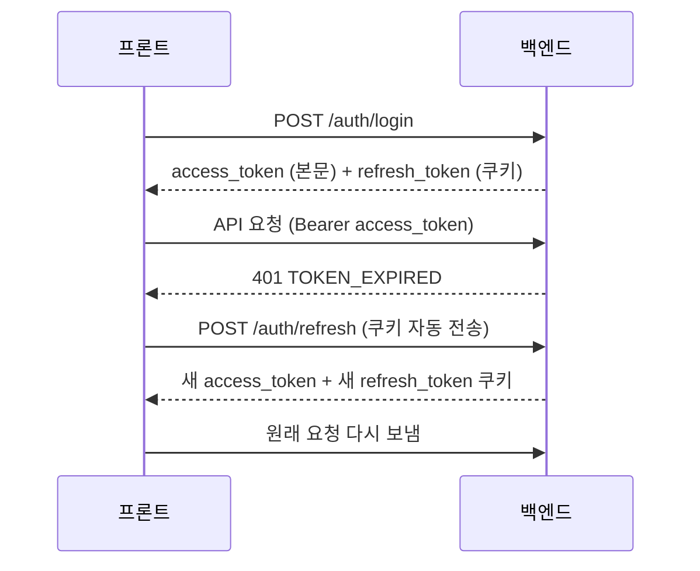
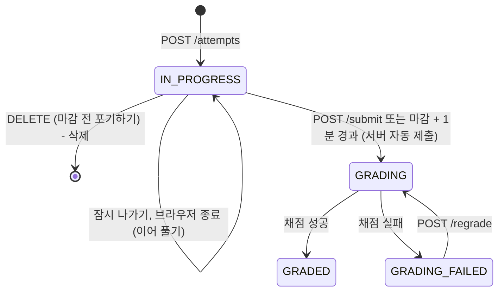

# API 명세서

## 1. 공통 규칙

| 항목 | 규칙 |
|---|---|
| 기본 주소 | `/api/v1` |
| 형식 | 요청과 응답 모두 JSON (`Content-Type: application/json`) |
| 필드 이름 | `snake_case` |
| 시각 | ISO 8601, UTC, 끝에 `Z`를 붙인다. 예: `2026-11-20T03:00:00Z`. DB의 `DATETIME`은 시간대가 없으므로 응답 스키마에서 UTC를 붙여 직렬화한다 |
| 인증 | `Authorization: Bearer {access_token}`. 🔒 표시한 API는 인증 필요 |
| ID | 경로의 `{id}`는 숫자 |

### 상태 코드

| 코드 | 쓰는 경우 |
|---|---|
| 200 OK | 조회, 수정 성공 |
| 201 Created | 생성 성공 |
| 202 Accepted | 접수했고 처리는 비동기로 진행 (채점) |
| 204 No Content | 삭제, 로그아웃 성공 |
| 400 Bad Request | 규칙에 맞지 않는 요청 (예: 없는 직무로 가입, 제한 시간이 지난 뒤 답안 저장) |
| 401 Unauthorized | 토큰이 없거나 만료됨 |
| 403 Forbidden | 조건 미충족 (예: 필수 강의 미수강) |
| 404 Not Found | 대상이 없음. 남의 응시처럼 접근 권한이 없는 대상도 404로 응답해 존재 여부를 숨긴다 |
| 409 Conflict | 현재 상태와 충돌 (예: 이미 있는 아이디, 시험 중이 아닌 응시에 제출) |
| 429 Too Many Requests | 요청 빈도, 동시 AI 처리, 응시 입력 한도 초과 |
| 422 Unprocessable Entity | 입력값 형식 오류 (FastAPI 기본 검증 응답) |
| 502 Bad Gateway | 외부 AI API 호출 실패 |

### 에러 응답

422를 제외한 에러는 아래 형식으로 응답한다. FastAPI 기본 형식(`{"detail": ...}`)과 다르므로 전역 예외 핸들러로 맞춘다. 프론트는 `code`로 분기하고, `message`는 화면에 그대로 보여줘도 되는 문장이다.

```json
{
  "error": {
    "code": "LECTURE_NOT_COMPLETED",
    "message": "이 과제는 필수 강의를 먼저 들어야 볼 수 있어요."
  }
}
```

### 에러 코드

| code | 상태 | 뜻 |
|---|---|---|
| `INVALID_CREDENTIALS` | 401 | 아이디 또는 비밀번호가 틀림 |
| `TOKEN_EXPIRED` | 401 | 액세스 토큰 만료. 재발급 후 다시 요청 |
| `INVALID_TOKEN` | 401 | 토큰이 잘못됨 |
| `INVALID_REFRESH_TOKEN` | 401 | 리프레시 토큰이 없거나 만료·폐기됨. 다시 로그인 |
| `LOGIN_ID_TAKEN` | 409 | 이미 있는 아이디 |
| `INVALID_JOB` | 400 | 없는 직무로 가입 |
| `LECTURE_NOT_FOUND` | 404 | 없는 강의, 또는 내 직무의 강의가 아님 |
| `TASK_NOT_FOUND` | 404 | 없는 과제, 또는 내 직무의 과제가 아님 |
| `ATTEMPT_NOT_FOUND` | 404 | 없는 응시, 또는 내 응시가 아님 |
| `LECTURE_NOT_COMPLETED` | 403 | 필수 강의 미수강 |
| `ATTEMPT_NOT_IN_PROGRESS` | 409 | 시험 중이 아닌 응시에 대화·답안·기록·제출·포기 요청 |
| `ATTEMPT_ALREADY_IN_PROGRESS` | 409 | 풀던 시험이 있는데 새 시험 시작 요청 |
| `ATTEMPT_TIME_OVER` | 400 | 제한 시간이 지난 뒤 대화·답안·기록 요청 |
| `ATTEMPT_INPUT_LIMIT` | 429 | 응시 기록 또는 채점 입력 한도 초과. 현재 저장된 답안으로 제출 가능 |
| `ATTEMPT_NOT_REGRADABLE` | 409 | 재채점할 수 없는 상태의 응시에 재채점 요청 |
| `CHAT_IN_PROGRESS` | 409 | 같은 응시에서 앞선 AI 답변 생성 중 다시 질문 |
| `IDEMPOTENCY_CONFLICT` | 409 | 같은 멱등 키를 다른 질문 내용에 재사용 |
| `ANSWER_REVISION_CONFLICT` | 409 | 더 최신 답안 뒤에 도착한 오래된 자동 저장 요청 |
| `AI_BUSY` | 429 | 동시 AI 요청 슬롯이 가득 참 |
| `AI_UNAVAILABLE` | 502 | AI 응답 실패. 다시 시도 가능 |

## 2. 인증 (JWT)

### 토큰 구성

| 토큰 | 형식 | 유효 기간 | 보관 위치 |
|---|---|---|---|
| 액세스 토큰 | JWT (HS256) | 1시간 | 프론트 메모리. `Authorization` 헤더로 보냄 |
| 리프레시 토큰 | 무작위 문자열 (서버 DB에 해시로 저장) | 14일 | `HttpOnly` 쿠키 |

액세스 토큰 페이로드:

```json
{
  "sub": "42",
  "type": "access",
  "sid": "9b9b9b...64자리 세션 식별자",
  "iat": 1795143600,
  "exp": 1795147200
}
```

- `sub`는 user id(문자열), `sid`는 로그인 세션에 연결된 토큰 패밀리 식별자다. 서명 키는 환경 변수 `JWT_SECRET`에 둔다.
- 토큰 검사는 `HTTPBearer(auto_error=False)`로 받아 직접 처리한다. 헤더가 없거나 잘못되면 401(`INVALID_TOKEN`), 만료면 401(`TOKEN_EXPIRED`)이다.
- 보호 API는 `sid`의 리프레시 토큰 패밀리가 폐기되지 않았는지도 확인한다. 로그아웃하면 해당 로그인 세션만 폐기되고, 같은 사용자의 다른 기기 세션은 유지된다.
- 리프레시 토큰은 매 재발급 때 회전한다. 폐기된 직전 토큰이 10초 안에 다시 오면 정상 경합으로 보고 401만 반환하며, 10초가 지난 재사용은 해당 토큰 패밀리를 모두 폐기한다.
- 레벨, 닉네임처럼 바뀌는 정보는 토큰에 넣지 않는다. `GET /users/me`로 조회한다.

리프레시 토큰 쿠키:

| 속성 | 값 |
|---|---|
| 이름 | `refresh_token` |
| HttpOnly | 예 (자바스크립트로 읽을 수 없음) |
| Secure | 배포 환경에서 예 |
| SameSite | Lax |
| Path | `/api/v1/auth` (인증 API에만 전송) |
| Max-Age | 14일 |

### 흐름



- 새로고침하면 메모리의 액세스 토큰이 사라지므로, 앱 시작 시 `POST /auth/refresh`를 먼저 호출해 로그인 상태를 복구한다. 401이면 로그인 화면으로 보낸다.
- 비밀번호는 bcrypt로 해시해 저장한다.
- 프론트는 재발급 요청을 하나로 묶는다. 여러 요청이 동시에 401을 받아도 `POST /auth/refresh`는 한 번만 보내고, 나머지는 그 결과를 기다린다.
- 프론트와 백엔드는 같은 출처로 서비스한다. 개발할 때는 Vite proxy로 `/api`를 백엔드(`localhost:8000`)에 넘기고, 배포할 때도 리버스 프록시로 `/api`를 백엔드에 넘긴다. 그래야 `SameSite=Lax` 쿠키가 전송되고 CORS 설정도 필요 없다.

### POST /auth/signup

회원가입. 가입 후 자동 로그인하지 않는다 (유저 플로우: 가입 → 로그인).

요청:

```json
{
  "login_id": "jiwon01",
  "password": "password1234",
  "nickname": "지원",
  "job_id": 1
}
```

| 필드 | 규칙 |
|---|---|
| login_id | 4~30자, 영문 소문자·숫자·밑줄(`_`) |
| password | 8~64자 |
| nickname | 2~20자 |
| job_id | `GET /jobs`에 있는 값 |

응답 `201`:

```json
{
  "id": 42,
  "login_id": "jiwon01",
  "nickname": "지원",
  "job": { "id": 1, "name": "무역 사무" },
  "level": 1
}
```

에러: `LOGIN_ID_TAKEN` 409, `INVALID_JOB` 400

### POST /auth/login

요청:

```json
{
  "login_id": "jiwon01",
  "password": "password1234"
}
```

응답 `200` (+ `Set-Cookie: refresh_token=...`):

```json
{
  "access_token": "eyJhbGciOiJIUzI1NiIs...",
  "token_type": "bearer",
  "expires_in": 3600
}
```

에러: `INVALID_CREDENTIALS` 401 (아이디가 없는 경우와 비밀번호가 틀린 경우를 구분하지 않는다)

### POST /auth/refresh

쿠키의 리프레시 토큰으로 액세스 토큰을 새로 받는다. 리프레시 토큰도 새로 발급하고 기존 것은 폐기한다.

요청 본문 없음. 응답은 로그인과 같다.

에러: `INVALID_REFRESH_TOKEN` 401 (없거나 만료·폐기된 토큰)

### POST /auth/logout

쿠키에 연결된 로그인 세션의 활성 리프레시 토큰을 폐기하고 쿠키를 지운다. 갱신과 로그아웃이 겹쳐도 같은 세션의 토큰이 남지 않는다. 응답 `204`.

## 3. 직무

### GET /jobs

회원가입 화면의 직무 선택 목록. 인증 불필요.

응답 `200`:

```json
[
  { "id": 1, "name": "무역 사무" }
]
```

## 4. 회원

### GET /users/me 🔒

맵 입장 시 호출. 캐릭터 모자 색과 첫 입장 안내 여부를 정한다.

응답 `200`:

```json
{
  "id": 42,
  "login_id": "jiwon01",
  "nickname": "지원",
  "job": { "id": 1, "name": "무역 사무" },
  "level": 2,
  "passed_task_count": 1,
  "tutorial_seen": false
}
```

- `level`: 1~6. 6이 Lv.MAX. 모자 색은 프론트가 레벨로 정한다 (1 노랑, 2 초록, 3 파랑, 4 보라, 5 빨강, 6 골드).

### PATCH /users/me 🔒

첫 입장 안내를 다 봤을 때 호출한다.

요청:

```json
{ "tutorial_seen": true }
```

응답 `200`: `GET /users/me`와 같음.

## 5. 강의

내 직무에서 현재 공개 중인 과정 버전의 강의만 다룬다. 다른 직무나 비활성 버전의 강의 id로 요청하면 `LECTURE_NOT_FOUND`. 기존 응시 결과는 당시 과제 스냅샷을 유지하지만 추천 강의는 같은 과정 키의 현재 활성 버전을 가리킨다.

### GET /lectures 🔒

강의 대시보드.

응답 `200`:

```json
{
  "completed_count": 1,
  "total_count": 5,
  "lectures": [
    {
      "id": 1,
      "title": "AI로 영문 비즈니스 메일 쓰고 검토하기",
      "duration_sec": 600,
      "progress_rate": 0.85,
      "completed": true
    },
    {
      "id": 2,
      "title": "AI로 견적 조건 정리하고 견적서 만들기",
      "duration_sec": 720,
      "progress_rate": 0.3,
      "completed": false
    }
  ]
}
```

- `progress_rate`: 0~1. 실제로 본 구간의 합 ÷ 영상 길이. 완료 전에는 계산값이 79.9%여도 최대 `0.79`로 표시하고, 정수식 `watched_sec × 5 >= duration_sec × 4`를 만족한 정확한 80%부터 완료 처리한다.
- 정렬: `sort_order` 순.

### GET /lectures/{id} 🔒

Phaser 강의실에서 강의를 선택하면 영상 패널을 열기 위해 호출한다. 연결된 과제 ID도 함께 받는다.

응답 `200`:

```json
{
  "id": 1,
  "title": "AI로 영문 비즈니스 메일 쓰고 검토하기",
  "youtube_video_id": "dQw4w9WgXcQ",
  "duration_sec": 600,
  "progress_rate": 0.85,
  "completed": true,
  "last_position_sec": 510,
  "task_id": 1
}
```

- 프론트는 유튜브 IFrame Player API로 영상을 띄우고 `last_position_sec`부터 재생한다. 패널에 수강 완료 기준(시청 구간 80%)과 현재 수강률을 표시한다.
- `task_id`는 이 강의와 연결된 과제 ID이며, 연결 과제가 없으면 `null`이다. `completed = true`이고 연결 과제가 있으면 ‘시험장으로 이동’을 표시한다.

### POST /lectures/{id}/progress 🔒

시청 기록 보고. 재생 중 10초마다, 그리고 일시정지·종료·화면 닫기 때 보낸다.

요청:

```json
{
  "watched_ranges": [[480, 510]],
  "position_sec": 510
}
```

| 필드 | 설명 |
|---|---|
| watched_ranges | 마지막 보고 이후 실제로 재생된 구간 목록 `[시작초, 끝초]`. 건너뛰기(seek)하면 구간을 끊고 새로 시작한다 |
| position_sec | 현재 재생 위치. 이어 보기에 쓴다 |

| 규칙 | 값 |
|---|---|
| 구간 수 | 한 번에 최대 20개 |
| position_sec | `0 ~ duration_sec` 범위로 자른다 |

서버 처리:

1. 각 구간을 `0 ~ duration_sec` 범위로 자르고, `끝 ≤ 시작`인 구간은 버린다.
2. 조작 방지: 이번 보고 구간 길이의 합이 `(현재 시각 − 마지막 보고 시각) + 5초`를 넘으면 초과분을 버린다. 첫 보고는 15초까지만 인정한다. 5초는 보고 지연을 흡수하는 허용 오차다. 이전 보고에서 이미 인정한 시간은 다음 보고에서 다시 인정하지 않는다.
3. 수강 기록 행을 `INSERT ... ON DUPLICATE KEY UPDATE`로 먼저 확보하고, `SELECT ... FOR UPDATE`로 잠근 뒤 처리한다. 보고가 겹쳐도 구간이 사라지지 않는다.
4. 기존 구간과 합쳐 겹치는 부분을 하나로 만든다. 같은 구간을 여러 번 봐도 한 번만 센다.
5. `watched_sec`를 다시 계산하고, 처음으로 80% 이상이 되면 `completed_at`을 기록한다.

응답 `200`:

```json
{
  "progress_rate": 0.88,
  "completed": true,
  "just_completed": false
}
```

- `just_completed`가 `true`면 이번 보고에서 처음 80%에 도달한 것이다. ‘수강 완료’를 표시하고, 연결 과제가 있으면 ‘시험장으로 이동’을 활성화한다. 이후 다시 보거나 새로고침한 경우 서버가 반환하는 `completed`로 이동 버튼 상태를 복원한다.

## 6. 과제

내 직무의 과제만 다룬다.

### GET /tasks 🔒

시험관 메뉴의 과제 목록.

응답 `200`:

```json
[
  {
    "id": 1,
    "title": "바이어 납기 지연 항의 메일 회신",
    "time_limit_min": 30,
    "required_lecture": {
      "id": 1,
      "title": "AI로 영문 비즈니스 메일 쓰고 검토하기",
      "completed": true
    },
    "available": true,
    "passed": false,
    "best_score": 85
  }
]
```

| 필드 | 설명 |
|---|---|
| available | 필수 강의 수강 완료 여부. `false`면 해당 과제를 잠금 표시하고 필수 강의와 ‘강의실로 이동’을 보여준다 |
| passed | 이 과제에 `GRADED AND passed = true`인 응시가 한 건 이상 있는지 |
| best_score | 채점된 응시 중 최고 총점. 없으면 `null`. 예를 들어 검증 최소 점수 미달이면 85점이어도 해당 응시는 미통과일 수 있다 |

### GET /tasks/{id} 🔒

시험장의 과제 안내 화면. 서버에서 필수 강의 수강 완료가 확인된 과제를 조회할 수 있다.

응답 `200`:

```json
{
  "id": 1,
  "title": "바이어 납기 지연 항의 메일 회신",
  "situation": "해외 바이어가 납기 지연에 항의하는 메일을 보냈다.",
  "instruction": "상황을 파악하고, 바이어에게 보낼 영문 회신 메일을 작성한다.",
  "time_limit_min": 30,
  "materials": [
    { "id": 1, "title": "바이어 메일 원문" },
    { "id": 2, "title": "계약서 일부" },
    { "id": 3, "title": "선적 일정표" }
  ],
  "criteria": [
    {"code": "RESULT", "name": "결과물", "dimension": "TASK_SOLUTION", "max_score": 50},
    {"code": "PROMPT", "name": "질문 설계", "dimension": "AI_USE", "max_score": 15},
    {"code": "VERIFY", "name": "답변 검증", "dimension": "AI_USE", "max_score": 20},
    {"code": "IMPROVE", "name": "개선 과정", "dimension": "AI_USE", "max_score": 15}
  ],
  "pass_requirements": {
    "version": "DUAL_V1",
    "task_solution_min_score": 40,
    "ai_use_min_score": 40,
    "verify_min_score": 12,
    "required_checks": [
      {
        "check_id": "SHIPPING_DATE",
        "label": "확정 선적일을 정확히 안내하고 미확정 일정을 확정처럼 약속하지 않기"
      }
    ]
  }
}
```

- `criteria`는 항목별 소속 영역과 배점이다. `TASK_SOLUTION`은 실무 과제 해결, `AI_USE`는 AI 활용 역량이다.
- `pass_requirements`는 영역별 최소 점수, 검증 최소 점수, 필수 요건의 공개 ID·설명이다. 응시 전 안내에는 현재 과제의 공개 기준을 사용한다.
- 안내 화면에는 자료 제목을 보여준다. 시험을 시작하면 자료 본문을 받는다.

에러: `TASK_NOT_FOUND` 404, `LECTURE_NOT_COMPLETED` 403

## 7. 응시 (시험)

### 응시 상태



### 시간 규칙

- 제한 시간은 서버의 `deadline_at`이 기준이다. 프론트 타이머는 표시용이다.
- 프론트는 남은 시간이 0이 되면 `POST /attempts/{id}/submit`을 보낸다.
- 서버는 네트워크 지연을 고려해 `deadline_at + 1분`까지 제출을 받는다.
- 마감 뒤 유예 시간에 제출하면 요청 본문의 답안을 신뢰하지 않고, 마감 시각 이전에 서버가 저장한 마지막 `answer_revision`을 최종 답안으로 사용한다.
- `deadline_at + 1분`이 지나도 `IN_PROGRESS`인 응시는 서버가 마감 시각 이전에 저장된 마지막 답안으로 자동 제출하고 채점한다. 절전이나 네트워크 끊김으로 제출이 늦어도 푼 내용을 잃지 않는다. 상시 작업자가 만료 응시를 찾고, 응시 조회·생성 API도 보완적으로 만료를 처리한다.
- 시험 중에 나가도(잠시 나가기, 브라우저 종료) 응시는 남고 제한 시간은 계속 흐른다. 다시 오면 `GET /attempts/current`로 이어 푼다.
- `deadline_at`이 지나면 대화, 답안 저장, 행동 기록과 포기는 받지 않는다. 제출만 유예 시간 안에 받는다.
- 응답에 `remaining_sec`(서버 기준 남은 초)를 함께 준다. 프론트 타이머는 사용자 PC 시계가 아니라 이 값으로 시작한다.

### POST /attempts 🔒

과제 안내에서 ‘시험 시작’을 눌렀을 때 호출한다. 응시가 생성되면 제한 시간이 시작된다.

요청:

```json
{ "task_id": 1 }
```

서버 처리:

1. 내 직무의 과제인지, 필수 강의를 수강 완료했는지 확인한다.
2. 사용자 행을 `SELECT ... FOR UPDATE`로 잠근다. 동시에 두 번 시작해도 응시가 둘 생기지 않는다.
3. 이 사용자의 `IN_PROGRESS` 응시가 있으면, 마감 + 1분이 지났으면 자동 제출하고 계속 진행한다. 아직 시간이 남았으면 `ATTEMPT_ALREADY_IN_PROGRESS` 409를 준다. 이어 풀거나 포기해야 새 시험을 시작할 수 있다.
4. 새 응시를 만들고 `task.grading_rubric`을 `attempt.grading_rubric_snapshot`에, 과제 제목·상황·지시·자료를 `attempt.task_snapshot`에 복사한다. `deadline_at = started_at + time_limit_min`으로 계산한다.
5. 응시 화면에 필요한 자료 본문과 스냅샷의 공개 평가 기준을 함께 반환한다.

응답 `201`:

```json
{
  "id": 1001,
  "status": "IN_PROGRESS",
  "started_at": "2026-11-20T03:00:00Z",
  "deadline_at": "2026-11-20T03:30:00Z",
  "remaining_sec": 1800,
  "task": {
    "id": 1,
    "title": "바이어 납기 지연 항의 메일 회신",
    "situation": "해외 바이어가 납기 지연에 항의하는 메일을 보냈다.",
    "instruction": "상황을 파악하고, 바이어에게 보낼 영문 회신 메일을 작성한다.",
    "materials": [
      { "id": 1, "title": "바이어 메일 원문", "content": "Dear Mr. Kim, ..." },
      { "id": 2, "title": "계약서 일부", "content": "납기 및 통지 조건 ..." },
      { "id": 3, "title": "선적 일정표", "content": "11월 28일 확정, 11월 25일 미확정 ..." }
    ],
    "criteria": [
      {"code": "RESULT", "name": "결과물", "dimension": "TASK_SOLUTION", "max_score": 50},
      {"code": "PROMPT", "name": "질문 설계", "dimension": "AI_USE", "max_score": 15},
      {"code": "VERIFY", "name": "답변 검증", "dimension": "AI_USE", "max_score": 20},
      {"code": "IMPROVE", "name": "개선 과정", "dimension": "AI_USE", "max_score": 15}
    ],
    "pass_requirements": {
      "version": "DUAL_V1",
      "task_solution_min_score": 40,
      "ai_use_min_score": 40,
      "verify_min_score": 12,
      "required_checks": [
        {
          "check_id": "SHIPPING_DATE",
          "label": "확정 선적일을 정확히 안내하고 미확정 일정을 확정처럼 약속하지 않기"
        }
      ]
    }
  }
}
```

에러: `TASK_NOT_FOUND` 404, `LECTURE_NOT_COMPLETED` 403, `ATTEMPT_ALREADY_IN_PROGRESS` 409

### GET /attempts/current 🔒

Phaser 시험장 입구의 상호작용 지점에서 시험 패널을 열 때 호출한다. 이어 풀 응시나 확인할 결과가 있는지 알려준다.

서버 처리: 시간 규칙에 따라 마감 + 1분이 지난 `IN_PROGRESS` 응시를 먼저 자동 제출한다.

응답 `200` (풀던 시험이 있음):

```json
{
  "id": 1001,
  "status": "IN_PROGRESS",
  "started_at": "2026-11-20T03:00:00Z",
  "deadline_at": "2026-11-20T03:30:00Z",
  "remaining_sec": 720,
  "answer": "Dear Mr. Smith, ...",
  "answer_revision_id": 712,
  "task": {
    "id": 1,
    "title": "바이어 납기 지연 항의 메일 회신",
    "situation": "해외 바이어가 납기 지연에 항의하는 메일을 보냈다.",
    "instruction": "상황을 파악하고, 바이어에게 보낼 영문 회신 메일을 작성한다.",
    "materials": [
      { "id": 1, "title": "바이어 메일 원문", "content": "Dear Mr. Kim, ..." },
      { "id": 2, "title": "계약서 일부", "content": "납기 및 통지 조건 ..." },
      { "id": 3, "title": "선적 일정표", "content": "11월 28일 확정, 11월 25일 미확정 ..." }
    ],
    "criteria": [
      {"code": "RESULT", "name": "결과물", "dimension": "TASK_SOLUTION", "max_score": 50},
      {"code": "PROMPT", "name": "질문 설계", "dimension": "AI_USE", "max_score": 15},
      {"code": "VERIFY", "name": "답변 검증", "dimension": "AI_USE", "max_score": 20},
      {"code": "IMPROVE", "name": "개선 과정", "dimension": "AI_USE", "max_score": 15}
    ],
    "pass_requirements": {
      "version": "DUAL_V1",
      "task_solution_min_score": 40,
      "ai_use_min_score": 40,
      "verify_min_score": 12,
      "required_checks": [
        {
          "check_id": "SHIPPING_DATE",
          "label": "확정 선적일을 정확히 안내하고 미확정 일정을 확정처럼 약속하지 않기"
        }
      ]
    }
  }
}
```

응답 `200` (나가 있는 동안 자동 제출됨, 결과를 아직 안 봄):

```json
{
  "id": 1001,
  "status": "GRADING",
  "auto_submitted": true
}
```

응답 `204`: 해당하는 시험 없음. 프론트는 시험관 메뉴를 보여준다.

| 필드 | 설명 |
|---|---|
| answer | 마지막으로 저장된 답안. 이어 풀 때 답안 입력란에 채운다 |
| answer_revision_id | 마지막 저장 답안의 수정본 ID. 다음 저장의 `expected_revision_id`로 사용한다 |
| auto_submitted | 사용자가 제출하지 않았는데 시간이 끝나 서버가 제출했는지 |

- 진행 중 응시가 있으면 ‘이어 풀기’를 표시한다. 마지막 저장 답안과 서버의 `remaining_sec`로 시험 화면을 복원하고, 대화 기록은 `GET /attempts/{id}/messages`로 받는다. 공개 평가 기준은 응시 스냅샷에서 반환한다.
- 확인할 응시가 있으면 ‘결과 확인’을 표시하고 `GET /attempts/{id}`를 사용한다. `GRADING`이면 채점 중 화면을 열고, `GRADING_FAILED`이면 채점 재시도를 제공한다.
- 결과 안내 대상은 `GRADING`, `GRADED`, `GRADING_FAILED` 상태 중 `result_seen_at`이 비어 있는 가장 최근 응시다.

### DELETE /attempts/{id} 🔒

포기하기. 마감 전 `IN_PROGRESS` 응시와 딸린 기록을 모두 삭제한다. 응답 `204`. 마감 뒤에는 서버 제출·채점으로 보존하므로 삭제하지 않는다.

- 잠시 나가기나 브라우저 종료 때는 호출하지 않는다. 응시가 남아 이어 풀 수 있다.

에러: `ATTEMPT_NOT_FOUND` 404, `ATTEMPT_NOT_IN_PROGRESS` 409

### POST /attempts/{id}/messages 🔒

시험 중 AI에게 질문. 질문과 답변을 모두 저장하고 AI 답변을 돌려준다.

요청:

```json
{ "content": "납기 지연에 항의한 바이어에게 보낼 영문 회신을 써 줘. 사과, 지연 사유, 선적일을 넣고 계약상 확정 가능한 일정만 약속해 줘." }
```

선택 헤더:

| 이름 | 규칙 | 설명 |
|---|---|---|
| `Idempotency-Key` | 영문·숫자·`.`·`_`·`-`, 1~64자 | 네트워크 재시도에서 같은 키와 같은 질문이면 저장된 한 턴을 재사용한다. 같은 키에 다른 질문이면 `IDEMPOTENCY_CONFLICT` |

| 필드 | 규칙 |
|---|---|
| content | 1~4000자 |

응답 `201`:

```json
{
  "user_message": {
    "id": 5001,
    "role": "USER",
    "content": "납기 지연에 항의한 바이어에게 보낼 영문 회신을 써 줘. 사과, 지연 사유, 선적일을 넣고 계약상 확정 가능한 일정만 약속해 줘.",
    "created_at": "2026-11-20T03:05:00Z"
  },
  "assistant_message": {
    "id": 5002,
    "role": "ASSISTANT",
    "content": "회신 초안입니다. 선적일은 11월 25일로 작성했습니다. ...",
    "created_at": "2026-11-20T03:05:04Z"
  }
}
```

- 서버는 이 응시의 이전 대화를 함께 보내 AI가 맥락을 알게 한다. 같은 응시의 AI 질문은 한 번에 하나만 처리한다.
- 대화는 최대 40턴이다. 대화와 답안 수정 이력은 JSON 직렬화 크기와 행당 160바이트 여유분을 합쳐 64KiB까지만 저장한다. 한도에 도달하면 `ATTEMPT_INPUT_LIMIT` 429를 주며, 이미 저장된 답안은 제출할 수 있다.
- AI가 실패하면 질문도 저장하지 않고 `AI_UNAVAILABLE` 502를 준다. 프론트는 "다시 시도" 버튼을 보여준다. 응시 마감 시각은 바뀌지 않으므로 AI 요청 중에도 제한 시간은 계속 흐른다.

에러: `ATTEMPT_NOT_IN_PROGRESS` 409, `ATTEMPT_TIME_OVER` 400, `CHAT_IN_PROGRESS` 409, `IDEMPOTENCY_CONFLICT` 409, `AI_BUSY` 429, `ATTEMPT_INPUT_LIMIT` 429, `AI_UNAVAILABLE` 502

### GET /attempts/{id}/messages 🔒

대화 기록 조회. 결과 화면과 지난 결과 보기에서 쓴다. `id` 오름차순.

응답 `200`:

```json
[
  { "id": 5001, "role": "USER", "content": "납기 지연에 항의한 바이어에게 보낼 영문 회신을 써 줘. 사과, 지연 사유, 선적일을 넣고 계약상 확정 가능한 일정만 약속해 줘.", "created_at": "2026-11-20T03:05:00Z" },
  { "id": 5002, "role": "ASSISTANT", "content": "회신 초안입니다. 선적일은 11월 25일로 작성했습니다. ...", "created_at": "2026-11-20T03:05:04Z" },
  { "id": 5003, "role": "USER", "content": "선적 일정표에서 확정일은 11월 28일이야. 초안의 25일을 28일로 고쳐 줘.", "created_at": "2026-11-20T03:06:00Z" },
  { "id": 5004, "role": "ASSISTANT", "content": "확정 선적일을 11월 28일로 고쳤습니다. ...", "created_at": "2026-11-20T03:06:04Z" },
  { "id": 5005, "role": "USER", "content": "사과는 첫 문장에 두고, 바이어가 새 일정을 바로 파악할 수 있게 28일을 다음 문장에 넣어 줘.", "created_at": "2026-11-20T03:07:00Z" },
  { "id": 5006, "role": "ASSISTANT", "content": "Dear Mr. Smith, we apologize for the delay. The confirmed shipping date is November 28. ...", "created_at": "2026-11-20T03:07:04Z" }
]
```

### PUT /attempts/{id}/answer 🔒

답안 저장. 입력이 멈춘 뒤 3초가 지나면 보낸다. 저장할 때마다 수정 이력이 한 줄씩 쌓인다.

요청:

```json
{ "content": "Dear Mr. Smith, ...", "expected_revision_id": 711 }
```

| 필드 | 규칙 |
|---|---|
| content | 0~20000자 |
| expected_revision_id | 선택. 화면이 알고 있는 마지막 `revision_id`. 최초 저장은 `null`. 더 최신 답안이 있으면 `ANSWER_REVISION_CONFLICT` |

응답 `200`:

```json
{ "saved_at": "2026-11-20T03:12:00Z", "revision_id": 712 }
```

- 직전에 저장한 내용과 같으면 이력을 쌓지 않는다.
- 답안 수정 이력은 최대 1,500개이며 대화와 합친 64KiB 한도를 적용한다. `content`는 20,000자 제한과 별도로 JSON 직렬화 크기 96KiB를 넘을 수 없다.

에러: `ATTEMPT_NOT_IN_PROGRESS` 409, `ANSWER_REVISION_CONFLICT` 409, `ATTEMPT_TIME_OVER` 400, `ATTEMPT_INPUT_LIMIT` 429

### POST /attempts/{id}/events 🔒

시험 중 행동 기록. 응답 `204`.

요청:

```json
{ "type": "PASTE", "payload": { "length": 320 } }
```

| type | 보내는 때 |
|---|---|
| PASTE | 답안이나 질문 입력란에 붙여넣기 |
| BLUR | 브라우저 탭이나 창을 벗어남 |
| FOCUS | 다시 돌아옴 |

- `type`은 위 세 값만 받는다. `payload`는 1KB까지.
- 행동 기록은 최대 600개다. 브라우저 이벤트는 필요한 `PASTE`, `BLUR`, `FOCUS`만 전송하고 원문 입력이나 불필요한 마우스·키보드 이벤트를 담지 않는다.
- 다른 시험 API와 같이 내 응시인지, 시험 중인지, 마감 전인지 확인한다.

에러: `ATTEMPT_NOT_FOUND` 404, `ATTEMPT_NOT_IN_PROGRESS` 409, `ATTEMPT_TIME_OVER` 400, `ATTEMPT_INPUT_LIMIT` 429

### POST /attempts/{id}/submit 🔒

제출. 채점은 MySQL 작업 큐를 처리하는 별도 작업자에서 비동기로 진행한다.

요청:

```json
{ "answer": "Dear Mr. Smith, ..." }
```

- `answer`는 최종 답안이다. 마지막 자동 저장 이후 바뀐 내용까지 반영하려고 함께 보낸다.
- 빈 답안도 받는다. "답안이 비어 있어요" 확인은 프론트에서 한다.
- 마감 전 제출은 본문의 답안을 사용한다. 마감 뒤 1분 유예 시간의 제출은 조작을 막기 위해 마감 전에 저장된 마지막 수정본을 사용한다. 최종 답안은 JSON 직렬화 크기 96KiB를 넘을 수 없다.

응답 `202`:

```json
{ "id": 1001, "status": "GRADING" }
```

- 프론트는 결과가 나올 때까지 2초마다 `GET /attempts/{id}`를 호출해 `status`를 확인한다.
- 응시 상태 변경과 `grading_job` 생성은 같은 트랜잭션에서 수행한다. "제출" 클릭과 서버 자동 제출이 동시에 와도 채점 작업은 하나만 생성된다.

에러: `ATTEMPT_NOT_FOUND` 404, `ATTEMPT_NOT_IN_PROGRESS` 409 (이미 제출됨 또는 마감 + 1분 경과)

### POST /attempts/{id}/regrade 🔒

채점 실패한 응시를 다시 채점. 응답 `202`, 형식은 제출과 같다.

- `status='GRADING_FAILED'` 조건의 조건부 UPDATE로 `GRADING`으로 바꾼다. 같은 응시의 답안, 기록, 채점 기준 스냅샷으로 다시 채점한다.

에러: `ATTEMPT_NOT_FOUND` 404, `ATTEMPT_NOT_REGRADABLE` 409

### GET /attempts/{id} 🔒

응시 결과. `GRADED`가 되기 전에는 `scores`, `total_score`, `passed`, `dimensions`, `required_checks`, `summary_feedback`이 `null`이다.

- 내 응시가 `GRADED` 상태로 처음 조회되면 `result_seen_at`을 기록하고 `first_view: true`를 준다.

응답 `200` (채점 완료, 검증 기준 미달):

```json
{
  "id": 1001,
  "status": "GRADED",
  "task": {
    "id": 1,
    "title": "바이어 납기 지연 항의 메일 회신"
  },
  "started_at": "2026-11-20T03:00:00Z",
  "submitted_at": "2026-11-20T03:27:10Z",
  "answer": "Dear Mr. Smith, the confirmed shipping date is November 28. ...",
  "content_snapshot_status": "FROZEN",
  "total_score": 85,
  "passed": false,
  "pass_requirements": {
    "version": "DUAL_V1",
    "task_solution_min_score": 40,
    "ai_use_min_score": 40,
    "verify_min_score": 12,
    "required_checks": [
      {
        "check_id": "SHIPPING_DATE",
        "label": "확정 선적일을 정확히 안내하고 미확정 일정을 확정처럼 약속하지 않기"
      }
    ]
  },
  "dimensions": [
    {
      "code": "TASK_SOLUTION",
      "name": "실무 과제 해결",
      "score": 45,
      "max_score": 50,
      "min_score": 40,
      "passed": true
    },
    {
      "code": "AI_USE",
      "name": "AI 활용 역량",
      "score": 40,
      "max_score": 50,
      "min_score": 40,
      "passed": false
    }
  ],
  "required_checks": [
    {
      "check_id": "SHIPPING_DATE",
      "label": "확정 선적일을 정확히 안내하고 미확정 일정을 확정처럼 약속하지 않기",
      "met": true,
      "feedback": "회신의 확정 선적일(11월 28일)이 일정표와 일치해요."
    }
  ],
  "summary_feedback": "정확한 선적일을 회신에 반영했어요. 현업에서는 발송 전 AI 초안에 들어간 모든 날짜의 확정 여부를 최신 선적 일정표와 대조해 보세요.",
  "scores": [
    {
      "criterion": "RESULT",
      "name": "결과물",
      "dimension": "TASK_SOLUTION",
      "score": 45,
      "max_score": 50,
      "feedback": "선적 일정표의 확정일과 지연 사유를 정확히 안내했어요. 회신에서 후속 조치를 더 구체화할 수 있어요.",
      "evidence_message_id": null,
      "evidence_revision_id": null
    },
    {
      "criterion": "PROMPT",
      "name": "질문 설계",
      "dimension": "AI_USE",
      "score": 15,
      "max_score": 15,
      "feedback": "바이어의 문의 내용, 회신 목적, 영문 작성 조건을 AI에 전달했어요.",
      "evidence_message_id": 5001,
      "evidence_revision_id": null
    },
    {
      "criterion": "VERIFY",
      "name": "답변 검증",
      "dimension": "AI_USE",
      "score": 11,
      "max_score": 20,
      "feedback": "AI가 제시한 선적일을 일정표에서 확인했어요. AI가 제안한 지연 사유도 자료와 대조했는지는 기록에서 확인하기 어려웠어요.",
      "evidence_message_id": 5003,
      "evidence_revision_id": null
    },
    {
      "criterion": "IMPROVE",
      "name": "개선 과정",
      "dimension": "AI_USE",
      "score": 14,
      "max_score": 15,
      "feedback": "확정 날짜를 반영하고 바이어가 이해하기 쉽게 사과 표현을 조정했어요.",
      "evidence_message_id": 5005,
      "evidence_revision_id": null
    }
  ],
  "recommended_lecture": {
    "id": 1,
    "title": "AI로 영문 비즈니스 메일 쓰고 검토하기"
  },
  "level_up": {
    "leveled_up": false,
    "level": 1
  },
  "first_view": true
}
```

| 필드 | 설명 |
|---|---|
| pass_requirements | 이 응시의 채점 기준 스냅샷에서 가져온 공개 기준. 현재 기준은 과제 안내와 같은 구조 |
| content_snapshot_status | `FROZEN`이면 응시 시작 당시 `task_snapshot`으로 채점·표시, `LEGACY_LIVE`이면 스냅샷 도입 전 응시라 현재 과제 내용을 보완 조회 |
| scores | 네 채점 항목의 소속 영역, 점수, 배점, 피드백과 대화·답안 수정 근거 ID |
| dimensions | 두 영역의 점수, 배점, 최소 점수, 최종 충족 여부. 영역 점수 외에 필수 요건과 검증 최소 점수도 반영 |
| required_checks | 필수 요건의 `check_id`, 공개 설명, `met`, 판정 근거. 기준에 요건이 없으면 빈 배열 |
| passed | 두 영역의 충족 여부를 모두 만족하면 `true`. 서버가 저장한 최종 통과 판정 |
| evidence_message_id | 근거가 된 대화. 프론트는 대화 기록에서 이 메시지를 강조한다 |
| evidence_revision_id | 근거가 된 답안 수정본. 실제 AI 답변 이후 학습자가 남긴 수정만 검증 근거가 될 수 있다 |
| summary_feedback | 총평과 현업에서 다시 사용할 수 있는 구체적인 행동 한 가지 |
| recommended_lecture | 같은 과정 키의 현재 활성 강의. 과거 결과의 스냅샷을 유지하면서 재학습은 최신 공개 버전으로 연결 |
| level_up.leveled_up | 이 응시로 레벨이 올랐는지. `true`면 맵으로 돌아갈 때 레벨업 연출 |
| first_view | 이번에 결과를 처음 보는지. 레벨업 연출은 `first_view`가 `true`일 때만 한다. 지난 결과를 다시 볼 때 연출이 반복되지 않는다 |
| level_up.level | 현재 레벨 |

- 예시에서는 실무 과제 해결 45/50점은 충족이다. AI 활용은 40/50점이고 `VERIFY`가 11/20점으로 검증 최소 점수(12점)에 미달해 최종 미통과다. 결과 화면에서 미충족 영역의 이유를 함께 보여준다.
- 이전 기준(`LEGACY_TOTAL_V1`)으로 시작한 응시는 `pass_requirements: {"version":"LEGACY_TOTAL_V1","min_total_score":80}`과 기존 총점 판정을 사용한다. 응시 시작·이어 풀기·조회에서 항목별 배점은 해당 스냅샷의 25점으로 표기하고, 결과의 `dimensions`과 `required_checks`는 `null`이다.

### GET /attempts 🔒

지난 결과 목록. 내 응시 중 `GRADING`, `GRADED`, `GRADING_FAILED`만 보여준다. 최신순. `passed`는 응시에 저장된 판정을 반환하며, 채점 완료 전에는 `null`이다.

쿼리:

| 이름 | 기본값 | 설명 |
|---|---|---|
| task_id | 없음 | 특정 과제의 응시만 |
| page | 1 | |
| size | 20 | 최대 100 |

응답 `200`:

```json
{
  "items": [
    {
      "id": 1001,
      "task": { "id": 1, "title": "바이어 납기 지연 항의 메일 회신" },
      "status": "GRADED",
      "submitted_at": "2026-11-20T03:27:10Z",
      "total_score": 85,
      "passed": false
    }
  ],
  "page": 1,
  "size": 20,
  "total": 1
}
```

## 8. 멀티플레이 (WebSocket)

같은 Phaser 2D 씬의 광장, 강의실, 시험장에서 접속 중인 캐릭터의 위치와 방향을 WebSocket으로 공유한다. 수강 완료, 과제 해금, 응시 상태는 REST API로 확인한다.

### 연결

| 항목 | 내용 |
|---|---|
| 주소 | `wss://{도메인}/api/v1/ws/map` (개발: `ws://localhost:5173/api/v1/ws/map`, Vite proxy에 `ws: true`) |
| 연결 시점 | Phaser 씬에 들어갈 때 연결한다. 씬 위에 강의·시험 패널이 열린 동안 연결을 유지하고, 씬을 떠나거나 로그아웃하면 닫는다 |
| 인증 | 브라우저 WebSocket은 헤더를 붙일 수 없어서, 연결 직후 첫 메시지로 액세스 토큰을 보낸다. 5초 안에 인증하지 않으면 서버가 닫는다 |
| 메시지 형식 | JSON. 모든 메시지에 `type`이 있다 |
| Origin | 배포에서 `WS_ALLOWED_ORIGINS` 허용 목록 또는 현재 호스트와 같은 Origin만 허용한다 |

토큰을 주소(쿼리)에 넣지 않는 이유: 주소는 서버 로그와 프록시 로그에 남는다.

### 클라이언트 → 서버

| type | 보내는 때 | 본문 |
|---|---|---|
| `auth` | 연결 직후 한 번 | `{"type": "auth", "access_token": "eyJ..."}` |
| `move` | 캐릭터가 움직일 때. 최대 초당 10번 | `{"type": "move", "x": 960, "y": 880, "dir": "down", "moving": true}` |

- `x`와 `y`는 변환 없이 바로 쓰는 Phaser 월드 픽셀 좌표다. 기본 맵 범위는 `x=0~1920`, `y=0~1408`이며 서버가 범위 밖 값을 경계로 제한한다.
- `dir`은 `up`, `down`, `left`, `right` 중 하나다. 시작 위치와 방향은 `(960, 880, down)`이다. 서버는 유한한 숫자 좌표, 허용 방향 문자열, 불리언 `moving`을 받은 경우에만 위치를 갱신한다.
- `moving`은 걷는 중이면 `true`다. 멈추거나 강의·시험 패널을 열 때 `false`로 한 번 보낸다. 수강 완료 직후 시험장으로 이동할 때는 이동한 위치를 보낸다.
- 초당 10번을 넘는 `move`는 버린다.

### 서버 → 클라이언트

| type | 받는 때 | 본문 |
|---|---|---|
| `snapshot` | 인증 성공 직후 한 번 | 지금 맵에 있는 다른 사용자 전체 (아래 예시) |
| `player_joined` | 다른 사용자가 들어옴 | `{"type": "player_joined", "player": {...}}` |
| `player_moved` | 다른 사용자가 움직임 | `{"type": "player_moved", "user_id": 7, "x": 968, "y": 880, "dir": "right", "moving": true}` |
| `player_updated` | 다른 사용자의 레벨이 바뀜 | `{"type": "player_updated", "user_id": 7, "level": 3}` |
| `player_left` | 다른 사용자가 나감 | `{"type": "player_left", "user_id": 7}` |

`snapshot` 예시:

```json
{
  "type": "snapshot",
  "me": { "x": 960, "y": 880, "dir": "down" },
  "players": [
    { "user_id": 7, "nickname": "서연", "level": 3, "x": 968, "y": 880, "dir": "right", "moving": false }
  ]
}
```

- `me`는 메인 광장 분수 앞의 접속 시작 위치와 방향이다.
- `player_joined`의 `player`는 `snapshot.players`의 각 항목과 같은 구조다. `player.level`로 모자 색을 정한다.

### 연결 종료 코드

| 코드 | 뜻 | 프론트 처리 |
|---|---|---|
| 4401 | 인증 실패, 5초 안에 인증 안 함, 로그인 세션 폐기·만료 | 토큰을 재발급하고 다시 연결. 또 실패하면 로그인 화면 |
| 4403 | 허용되지 않은 Origin | 연결 설정과 `WS_ALLOWED_ORIGINS`를 확인하고 자동 재연결하지 않는다 |
| 4409 | 같은 계정이 다른 탭이나 기기에서 접속 | "다른 곳에서 접속했어요" 안내. 다시 연결하지 않는다 |
| 1009 | 메시지가 2,048바이트를 초과 | 메시지 크기를 줄이고 연결을 다시 시작한다 |
| 그 밖 (네트워크 끊김 등) | | 1초, 2초, 4초… 최대 10초 간격으로 다시 연결 |

### 서버 처리

- 접속 중인 사용자와 위치는 서버 메모리에 둔다. DB에 저장하지 않는다.
- 같은 계정이 새로 접속하면 기존 연결을 4409로 닫는다. 한 계정은 맵에 캐릭터 하나만 있다.
- 연결 중 15초마다 `sid` 세션이 여전히 유효한지 확인한다. 로그아웃·리프레시 재사용 탐지로 세션이 폐기되면 4401로 닫는다.
- 강의나 시험 화면을 여는 동안에도 연결은 유지한다. 캐릭터는 그 자리에 서 있는 것으로 보인다.
- 채점으로 레벨이 오르면 모두에게 `player_updated`를 보낸다.
- 서버 메모리에 상태를 두므로 백엔드는 프로세스 하나로 띄운다 (uvicorn worker 1개). 여러 대로 늘릴 때는 Redis Pub/Sub 같은 공유 저장소가 필요하다.

## 9. 채점 (서버 내부)

프론트는 응시 API로 채점 상태와 결과를 조회한다. 채점은 아래 순서로 실행한다.

1. 일반 제출, 서버 자동 제출, 채점 재시도에서 응시를 `GRADING`으로 바꾸면서 같은 MySQL 트랜잭션에 `grading_job`을 넣는다. 별도 작업자는 1초마다 만료 응시와 실행 가능한 작업을 최대 20개씩 스캔한다.
2. 작업자는 `SELECT ... FOR UPDATE SKIP LOCKED`로 작업을 가져와 15분 임대 토큰을 발급한다. 저장 직전에도 같은 토큰과 미만료 임대를 확인하는 fencing으로 늦게 끝난 이전 작업자가 결과를 덮어쓰지 못하게 한다. 한 작업은 최대 3번 가져가며 실패 재시도는 5초, 30초 뒤다.
3. 채점 작업은 응시의 `task_snapshot`, 채점 기준 스냅샷, 최종 답안, AI 대화, 답안 수정 이력과 행동 기록을 읽는다. `RESULT`와 과제별 필수 요건은 최종 답안과 제공 자료를 대조해 판단한다. AI 활용 항목은 대화와 수정 이력에서 학습자의 행동을 평가한다.
   - 공개 과정 한 버전의 직렬화된 과제·자료는 32KiB, 대화와 답안 수정 이력은 행당 160바이트 여유분을 포함해 합계 64KiB, 최종 답안은 96KiB로 제한한다. 공급자에 보내는 전체 요청은 256KiB, 응답은 64KiB를 넘지 않으며 기본 제한 시간은 45초다. 저장 단계에서 한도를 먼저 막아 정상 응시가 채점 시점에 크기 오류로 실패하지 않게 한다.
   - 시스템 프롬프트에서 채점 지침과 평가 대상 데이터를 구분한다. 자료·답안·대화·수정 이력에 포함된 문장은 평가할 데이터로 취급한다.
   - `DUAL_V1`의 `VERIFY`가 양수면 무엇을 어떤 원자료와 대조했는지 피드백에 적고, 그 행동을 보여주는 같은 응시의 대화 또는 답안 수정 이력 ID를 제시한다. 검증 근거가 없으면 `VERIFY = 0`으로 평가한다.
4. `grade(context)`는 최종 답안·자료를 보내는 결과물 채점과 대화·답안 수정 이력을 보내는 과정 채점을 별도 JSON Schema 요청으로 실행한다. 두 응답을 `scores`, `required_checks`, `summary_feedback`으로 합친다. AI 답변을 그대로 복사한 답안, 첫 질문, AI 답변 전 기록은 학습자가 AI 답변을 검증한 근거로 쓰지 않는다. 같은 초에 저장된 수정도 `after_message_id`로 실제 AI 답변 이후인지 판단한다. `scores`의 항목은 `criterion`, `score`, `feedback`, `evidence_message_id`, `evidence_revision_id`를 포함한다. 필수 요건별로 `check_id`, `met`, 최종 답안과 자료에 근거한 `feedback`을 반환한다. 총평에 현업에서 다시 사용할 행동을 한 가지 담는다.
5. 서버가 응답을 검증한 뒤 판정한다.
   - 네 항목이 각각 한 번씩 있고, 점수가 스냅샷 배점 범위의 정수인지 검사한다. 필수 요건 ID는 스냅샷과 정확히 일치해야 하며(이전 기준은 빈 목록), `met`은 불리언이다. 제출된 근거 ID가 현재 응시 소속인지 확인한다.
   - 누락, 중복, 범위 오류, 잘못된 근거 ID가 있거나 `DUAL_V1`의 양수인 `VERIFY`에 근거 참조가 빠졌으면 AI 응답을 한 번 다시 요청한다. 재시도도 유효하지 않으면 채점 실패로 처리한다.
   - 스냅샷이 `DUAL_V1`이면 서버가 아래 식으로 점수와 판정을 계산한다. 예시 기준은 실무 과제 해결 40/50점, AI 활용 역량 40/50점, 검증 12/20점이다.

     ```text
     task_solution_score = RESULT
     task_solution_passed = RESULT >= task_solution_min_score AND 모든 필수 요건의 met = true
     ai_use_score = PROMPT + VERIFY + IMPROVE
     ai_use_passed = ai_use_score >= ai_use_min_score AND VERIFY >= verify_min_score
     total_score = task_solution_score + ai_use_score
     passed = task_solution_passed AND ai_use_passed
     ```

   - 기존 응시의 스냅샷이 `LEGACY_TOTAL_V1`이면 이전 항목별 25점 및 총점 80점 통과 규칙으로 완료한다. 이미 채점을 마친 응시는 저장된 결과와 판정을 조회한다.
6. 임대 토큰을 다시 확인한 뒤 한 트랜잭션으로 저장한다.
   - 사용자 행을 `SELECT ... FOR UPDATE`로 잠근다. 같은 과제의 응시 둘이 동시에 채점돼도 레벨이 두 번 오르지 않는다.
   - `attempt_score` 4행과 근거 메시지·수정본 ID, `required_check_results`, `total_score`, `passed`, `summary_feedback`을 함께 저장하고 `status = GRADED`로 바꾼다. 응시에는 실제 `grading_model`, `grading_prompt_version`을 감사 정보로 남긴다. 이전 기준의 응시는 `required_check_results = NULL`로 저장한다.
   - 레벨을 `min(1 + 통과한 서로 다른 과정 수, 6)`으로 다시 계산한다. 과정 버전이 달라도 같은 `job_id + catalog_key`는 한 번만 세고, 공개 과정 밖의 기존 과제는 `task_id`별로 센다. 값이 올랐으면 `leveled_up = true`로 저장하고 트랜잭션이 끝난 뒤 멀티플레이 연결로 `player_updated`를 보낸다.
7. 일시 오류는 임대를 풀고 다음 재시각까지 보류한다. 최대 3회 가져간 뒤에도 실패하거나 재시도할 수 없는 오류면 `status = GRADING_FAILED`와 축약된 `grading_failure`를 남긴다. 사용자는 `regrade`로 새 작업을 만들어 다시 시도할 수 있다.
8. 작업은 MySQL에 남으므로 서버가 재시작돼도 유실되지 않는다. 만료된 임대는 다른 작업자가 다시 가져가며, `GRADING`인데 작업 행이 없는 이전 데이터만 시작 시 `GRADING_FAILED`로 복구한다.

| 함수 | 쓰는 곳 | 입력 | 출력 |
|---|---|---|---|
| `chat(messages)` | `POST /attempts/{id}/messages` | 시스템 프롬프트 + 대화 기록 | AI 답변 문자열 |
| `grade(context)` | 채점 작업 | 응시 스냅샷, 과제, 자료, 답안, 기록 | 항목별 점수와 근거, 필수 요건별 판정과 근거, 총평 JSON |

## 10. Phaser 학습 동선과 화면별 사용 API

광장, 강의실, 시험장을 하나의 Phaser 2D 씬에 구성한다. 각 공간의 입구와 상호작용 지점은 맵 설정에서 지정한다. 영상, 과제 자료, AI 채팅, 답안, 결과는 씬 위의 웹 패널에서 보여준다.

1. **강의실 입장.** 강의실에서 강의를 선택하면 영상과 이어 보기 위치를 불러온다.
2. **수강 완료와 과제 해금.** 서버가 중복을 제외한 시청 구간을 80% 이상으로 기록하면 연결 과제를 해금한다. ‘시험장으로 이동’을 누르면 같은 씬의 시험장 입구로 이동하고, 연결된 과제를 안내 후보로 사용한다. 연결된 과제가 잠겨 있으면 필수 강의와 강의실 이동을 안내한다.
3. **시험장 입장과 응시 시작.** 입구의 상호작용 지점에서 패널을 열면, 진행 중인 응시 → 확인할 결과 → 선택한 과제 안내 또는 과제 목록 순으로 확인한다. 과제 안내에서 제한 시간, 공개 평가 기준, 자료 제목을 확인하고 ‘시험 시작’을 누르면 서버가 수강 완료를 확인하고 응시와 타이머를 시작한다.
4. **실무 과제 수행과 이어 풀기.** 제공 자료를 보며 AI와 대화하고 답안을 작성한다. ‘잠시 나가기’로 패널을 닫아도 제한 시간은 흐른다. 시험장에 다시 들어오면 남은 시간, 저장 답안, 대화를 복원한다. 마감 전 ‘포기하기’를 선택하면 확인 후 응시를 삭제한다.
5. **평가와 현업 적용.** 결과에 실무 과제 해결과 AI 활용 역량의 점수, 충족 여부, 미충족 이유와 근거를 표시한다. 총평의 현업 적용 행동을 함께 보여주고, 필요하면 추천 강의로 돌아갈 수 있게 한다.

| 화면 | API |
|---|---|
| 회원가입 | `GET /jobs`, `POST /auth/signup` |
| 로그인 | `POST /auth/login` |
| 앱 시작 (새로고침) | `POST /auth/refresh` → `GET /users/me` |
| 광장 입장 | `GET /users/me`, 첫 입장 안내 후 `PATCH /users/me`, WebSocket `/ws/map` 연결 |
| 강의실의 강의 목록 | `GET /lectures` |
| 강의실의 영상 패널 | `GET /lectures/{id}` → `POST /lectures/{id}/progress` |
| 시험장 패널 열기 | `GET /attempts/current`로 이어 풀기 또는 결과 확인을 먼저 안내 |
| 시험장 과제 목록과 안내 | `GET /tasks`, `GET /tasks/{id}` |
| 시험 시작과 이어 풀기 | 시작은 `POST /attempts`, 이어 풀기는 `GET /attempts/current`와 `GET /attempts/{id}/messages` |
| 시험 중 | `POST /attempts/{id}/messages`, `PUT /attempts/{id}/answer`, `POST /attempts/{id}/events`, `POST /attempts/{id}/submit`, 포기 확인 시 `DELETE /attempts/{id}` |
| 채점 중과 재시도 | `GET /attempts/{id}` (2초마다), 실패하면 `POST /attempts/{id}/regrade` |
| 결과와 지난 결과 보기 | `GET /attempts`, `GET /attempts/{id}`, `GET /attempts/{id}/messages` |
| 로그아웃 | `POST /auth/logout` |

## 11. 전체 목록

| 메서드 | 경로 | 인증 | 설명 |
|---|---|---|---|
| POST | /auth/signup | | 회원가입 |
| POST | /auth/login | | 로그인 |
| POST | /auth/refresh | 쿠키 | 토큰 재발급 |
| POST | /auth/logout | 쿠키 | 로그아웃 |
| GET | /jobs | | 직무 목록 |
| GET | /users/me | 🔒 | 내 정보 |
| PATCH | /users/me | 🔒 | 첫 입장 안내 완료 |
| GET | /lectures | 🔒 | 강의 대시보드 |
| GET | /lectures/{id} | 🔒 | 강의 상세 |
| POST | /lectures/{id}/progress | 🔒 | 시청 기록 보고 |
| GET | /tasks | 🔒 | 과제 목록 |
| GET | /tasks/{id} | 🔒 | 과제 안내 |
| POST | /attempts | 🔒 | 시험 시작 |
| GET | /attempts/current | 🔒 | 풀던 시험 / 안 본 결과 확인 |
| GET | /attempts | 🔒 | 지난 결과 목록 |
| GET | /attempts/{id} | 🔒 | 응시 결과 |
| DELETE | /attempts/{id} | 🔒 | 포기하기 |
| POST | /attempts/{id}/messages | 🔒 | AI에게 질문 |
| GET | /attempts/{id}/messages | 🔒 | 대화 기록 |
| PUT | /attempts/{id}/answer | 🔒 | 답안 저장 |
| POST | /attempts/{id}/events | 🔒 | 행동 기록 |
| POST | /attempts/{id}/submit | 🔒 | 제출 |
| POST | /attempts/{id}/regrade | 🔒 | 재채점 |
| WS | /ws/map | 첫 메시지 | 멀티플레이 (캐릭터 위치 공유) |
